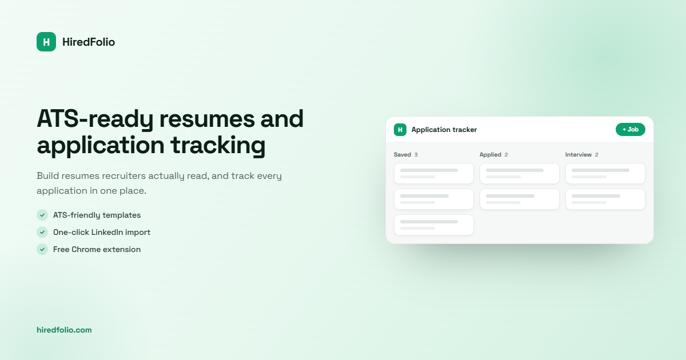

<div align="center">

# Lucas Zebre

**Fullstack / Product Engineer · Building [HiredFolio](https://hiredfolio.com/?utm_source=github&utm_medium=referral&utm_campaign=directory-listings&utm_content=profile-readme)**


</div>

---

### 🔥 Now

Building **[HiredFolio](https://hiredfolio.com/?utm_source=github&utm_medium=referral&utm_campaign=directory-listings&utm_content=profile-readme)** — a job tracker that tailors your resume: save jobs in one click from LinkedIn, Indeed or Welcome to the Jungle, fit your CV to each posting, score it against the ATS, and track every application on a kanban board until you sign.

<a href="https://hiredfolio.com/?utm_source=github&utm_medium=referral&utm_campaign=directory-listings&utm_content=profile-readme"></a>

**How it works**

1. **Capture in one click** — the Chrome extension saves a job from LinkedIn, Indeed, Welcome to the Jungle, HelloWork or APEC straight to your board.
2. **Tailor with AI** — your resume is rewritten for that exact role from your real experience, then scored against the ATS before you send it.
3. **Track to offer** — every application moves through a kanban board with notes and follow-up reminders that actually fire.

**Under the hood** — pnpm monorepo: React 19 + Vite front, Hono API with OpenAPI docs, Chrome extension (Manifest V3), PostgreSQL + Prisma, Redis + BullMQ workers, Docker on a VPS with Coolify and blue-green deploys, Sentry + PostHog, CI on GitHub Actions.


---

### 📍 Next

Apprentice Web Engineer at **Holis** until **January 2027**.
From **February 2027** I'm open to **Product Engineer** roles (Paris or remote) while completing a **Bac+5** (master's level). If you're building something and want someone who ships end to end, let's talk.

---

### ⚙️ Stack

```
Frontend   →  React · TypeScript · Vite · TailwindCSS · Redux Toolkit
Backend    →  Hono · Node.js · Prisma · BullMQ
Data       →  PostgreSQL · Redis
AI         →  Anthropic SDK · OpenAI SDK
DevOps     →  Docker · Coolify · GitHub Actions · Blue-Green Deploys
Also       →  Next.js · NestJS · Express · MongoDB
```

---

### 📂 Projects

**LetterEasy** · Motivation letter SaaS
[**KanbanTaskManager**](https://github.com/lucaszebre/kanbanwithapi) · Kanban board — React, Vite, TanStack Query · [API](https://github.com/lucaszebre/KanbanExpressAPi): Express, Prisma
[**ChatPet**](https://github.com/lucaszebre/ChatPet) · Chat assistant with uploads — React, Hono on Cloudflare Workers, D1
[**InstaClone**](https://github.com/lucaszebre/instaclone) · Instagram clone
[**InvoiceApp**](https://github.com/lucaszebre/invoice) · Invoice management tool


<div align="center">

Apprentice Web Engineer @ Holis · Open to Product Engineer roles from Feb 2027 · Shipping HiredFolio 🛠️


</div>
